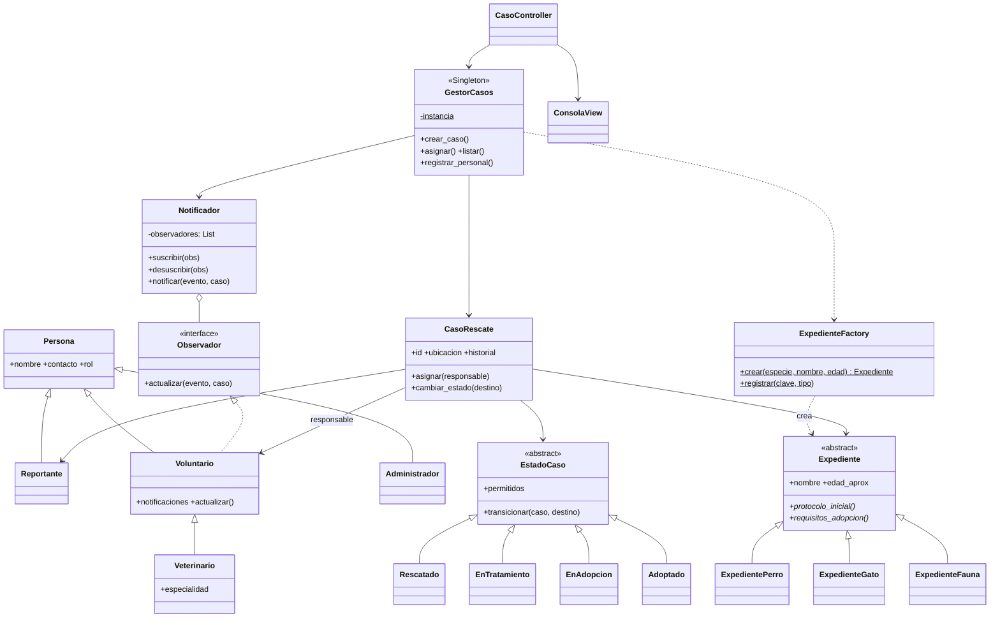
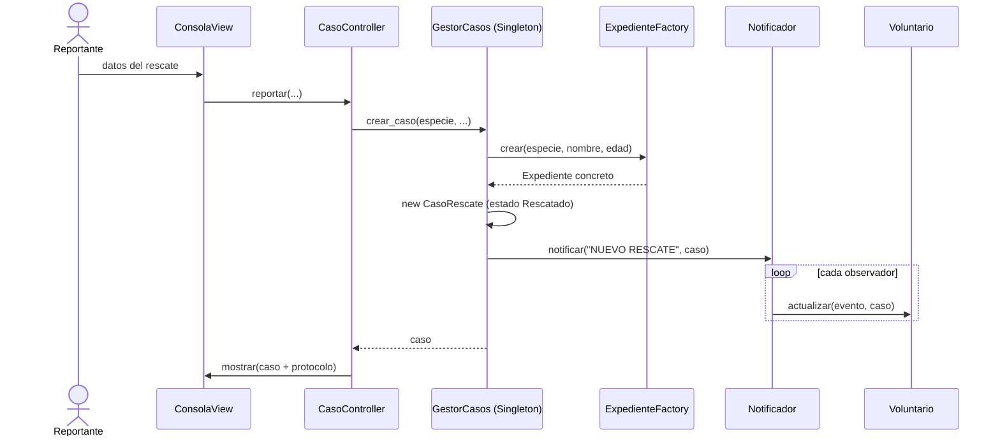
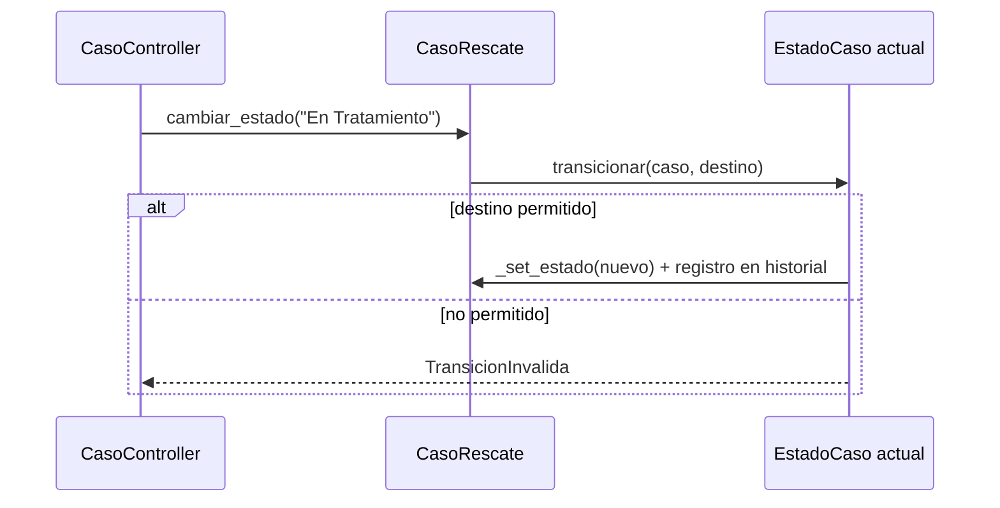

# Sistema de Control de Rescate y Adopción Animal
**Universidad Técnica de Manabí — Desarrollo de Sistemas Informáticos**
**Unidad 1: Desarrollo de software, introducción y paradigmas de diseño**
**Actividad #1: Estudio de caso** — Autor: Carlos Bustos — Repositorio: https://github.com/cbustos4025-del/rescate_animal_act3/blob/develop/docs/DOCUMENTACION.md

## 1. Análisis del problema
### 1.1 Actores
| Actor | Descripción |
|---|---|
| Ciudadano / Reportante | Reporta el ingreso de un animal que requiere rescate |
| Voluntario | Recibe alertas, atiende casos y actualiza estados |
| Veterinario | Es un voluntario con atribuciones clínicas (registra tratamiento) |
| Administrador del Refugio | Registra personal, asigna responsables y gestiona adopciones |

### 1.2 Requerimientos funcionales
- RF1. Crear caso de rescate (perro, gato, fauna silvestre).
- RF2. Categorizar la especie y generar el expediente correspondiente.
- RF3. Asignar un voluntario o veterinario responsable.
- RF4. Gestionar estados: Rescatado → En Tratamiento → En Adopción → Adoptado.
- RF5. Notificar automáticamente a los voluntarios ante un nuevo rescate.
- RF6. Consultar el historial de cada caso.

### 1.3 Requerimientos no funcionales
- RNF1. **Escalabilidad:** nuevas especies o estados sin modificar código existente (OCP).
- RNF2. **Mantenibilidad:** capas separadas (MVC), clases con una sola responsabilidad.
- RNF3. **Trazabilidad:** historial con fecha/hora de cada cambio del caso y control de versiones con Gitflow.

## 2. Diseño del sistema
### 2.1 Diagrama de casos de uso
Archivo fuente: `docs/casos_de_uso.puml` (extensión *PlantUML* de VS Code, `Alt+D`; o https://www.plantuml.com/plantuml).

### 2.2 Diagrama de clases UML (principios SOLID)


**Aplicación de SOLID**
| Principio | Dónde se aplica |
|---|---|
| **S** (Responsabilidad única) | `CasoRescate` guarda datos del caso; `Notificador` solo avisa; `ExpedienteFactory` solo crea; la Vista solo muestra |
| **O** (Abierto/Cerrado) | Nueva especie: `ExpedienteFactory.registrar()`; nuevo estado: nueva subclase de `EstadoCaso` |
| **L** (Sustitución de Liskov) | `ExpedientePerro/Gato/Fauna` y `Veterinario` sustituyen a su base sin romper el sistema |
| **I** (Segregación de interfaces) | `Observador` es una interfaz mínima de un solo método |
| **D** (Inversión de dependencias) | `Notificador` depende de `Observador` (abstracción), no de `Voluntario`; el controlador no conoce detalles de las vistas |

### 2.3 Arquitectura general
```
┌──────────────┐  eventos  ┌────────────────────┐  usa   ┌──────────────────────────┐
│ Vista (CLI)  │──────────▶│ Controlador        │───────▶│ Modelo                   │
│ ConsolaView  │◀──────────│ CasoController     │        │ GestorCasos (Singleton)  │
└──────────────┘  mostrar  └────────────────────┘        │  ├ ExpedienteFactory     │
                                                          │  ├ CasoRescate + State   │
                                                          │  └ Notificador (Observer)│
                                                          └──────────────────────────┘
        Control de versiones: GitHub + Gitflow (master · develop · feature/* · release/*)
```

## 3. Patrones de diseño aplicados
| # | Patrón | Archivo | Problema que resuelve en el refugio |
|---|---|---|---|
| 1 | **Singleton** | `patterns/singleton.py` | Garantiza un único motor `GestorCasos` con un solo repositorio; evita casos duplicados o estados inconsistentes. Usa doble verificación con `Lock` (seguro con hilos). |
| 2 | **Observer** | `patterns/observer.py` | Al ingresar un rescate, todos los voluntarios suscritos son notificados automáticamente, sin acoplar el gestor a cada voluntario (base de la programación reactiva). |
| 3 | **Factory Method** | `patterns/factory.py` | Cada especie requiere un expediente distinto (protocolo médico, requisitos de adopción). La fábrica decide la clase concreta; el cliente no usa `if/else` por especie. |
| 4 | **MVC** | `models/ controllers/ views/` | Separa lógica de negocio, coordinación e interfaz; permite cambiar la consola por una web sin tocar el modelo. |
| 5 | **State** (adicional) | `patterns/state.py` | Cada estado define sus transiciones válidas; impide, por ejemplo, pasar de *Rescatado* a *Adoptado* sin tratamiento. |

## 4. Diagramas de secuencia
### 4.1 Reportar un rescate (Singleton + Factory + Observer + MVC)

### 4.2 Cambio de estado (State)


## 5. Justificación de Gitflow
| Rama | Propósito |
|---|---|
| `master` | Código estable, versiones publicadas (tag `v1.0.0`) |
| `develop` | Integración de funcionalidades |
| `feature/*` | Una rama por funcionalidad (`factory-expedientes`, `observer-notificaciones`, `state-estados`, `singleton-mvc`, `pruebas-docs`) |
| `release/*` | Preparación de la versión antes de pasar a `master` |

Gitflow aporta **trazabilidad de versiones** (RNF3), trabajo aislado por funcionalidad, `master` siempre estable y fusiones `--no-ff` que dejan visible el historial.

- **Enlace al repositorio:** https://github.com/cbustos4025-del/rescate_animal_act3
- **Capturas del historial:** _[inserta captura de `git log --graph --oneline --all` y de GitHub → Insights → Network]_

## 6. Conclusiones
Con este proyecto aprendí lo útil que es organizar bien el código desde el principio usando patrones de diseño, ya que todo queda separado por funciones y es mucho más fácil de entender y arreglar si algo falla. También me di cuenta de que usar Gitflow en GitHub ayuda bastante a trabajar en orden, porque permite probar cambios en ramas separadas sin dañar la versión principal del programa. En general, fue una buena práctica para entender cómo se estructura y se lleva el control de un sistema real paso a paso.
